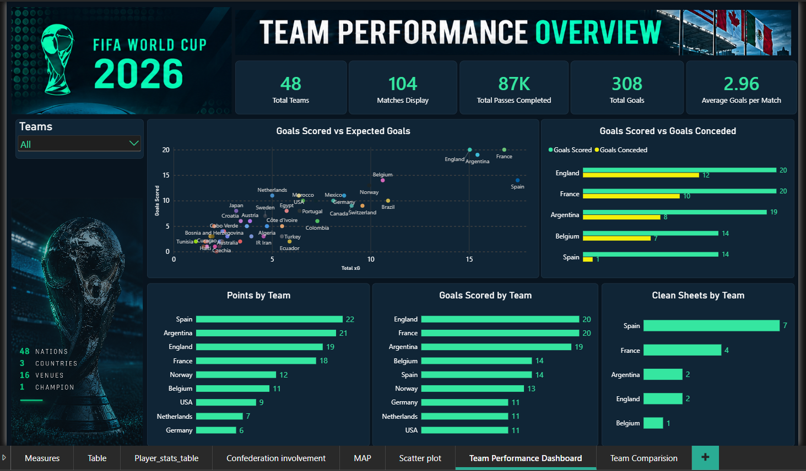
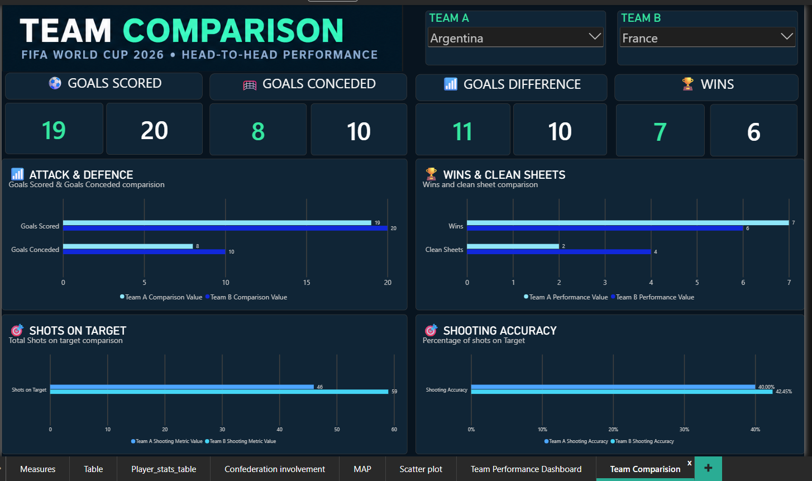

<div align="left">

# FIFA World Cup 2026 — Team Performance Analysis

## Football Analytics Project | MySQL · SQL · Power BI

## Project Overview

This project analyses FIFA World Cup 2026 data using **MySQL and Power BI** to uncover insights into team performance, player statistics, match outcomes, and tournament attendance.

The project uses a relational database to organise tournament data and SQL queries to answer 10 business questions. The results are presented through interactive Power BI dashboards.

### Project Objectives

- Analyse team performance using match statistics.
- Identify the strongest attacking and defensive teams.
- Evaluate player contributions through goals and assists.
- Compare shooting accuracy across teams.
- Explore stadium attendance and tournament statistics.
- Build interactive dashboards that communicate football insights effectively.

---

# Main Dashboard — Team Performance Overview

**The Team Performance Dashboard is the primary dashboard of this project.**

It provides an overview of tournament performance through key performance indicators and interactive visualisations, helping users explore team strengths, attacking output, defensive performance, and expected goals.



### Key Features

**1. Tournament Overview**

- Total teams
- Total matches
- Total goals
- Average goals per match
- Average attendance
- Total completed passes
- Total expected goals (xG)

**2. Goalscoring Performance**

Compare goals scored by teams to identify the strongest attacking performances in the dataset.

**3. Points by Team**

Explore team performance using the project's points calculation.

**4. Goals Scored vs. Goals Conceded**

Compare attacking and defensive performance to identify teams that balance scoring with defensive strength.

**5. Clean Sheets**

Identify teams that prevented their opponents from scoring in the greatest number of matches.

**6. Goals vs. Expected Goals (xG)**

Explore the relationship between actual goals scored and expected goals to understand differences in finishing output.

**7. Interactive Team Filtering**

Use the team filter to focus on individual teams and explore their performance across the dashboard.

### Dataset Snapshot

| Metric                          |                      Value |
| ------------------------------- | -------------------------: |
| Teams                           |                         48 |
| Matches                         |                        104 |
| Goals recorded in match results |                        308 |
| Average goals per match         |                       2.96 |
| Total attendance                | Approximately 6.81 million |
| Average attendance per match    |       Approximately 65,490 |
| Completed passes                |       Approximately 87,000 |
| Total expected goals (xG)       |                     265.62 |

*Note: These figures describe the dataset used in this project and are not independently verified official tournament statistics.*

### Important Data Insight

The match results contain **308 total goals**, while the player statistics table records **294 player-scored goals**.

The difference is explained by 14 own goals in the dataset. Own goals affect the final match scores but are not included in the player-goal total.

This distinction is important when analysing team performance versus individual player contributions.

---

# Supporting Dashboard — Team Comparison

The Team Comparison Dashboard complements the main dashboard by allowing users to select two teams and compare their performance side by side.



### Key Features

- Goals scored and goals conceded
- Wins and clean sheets
- Shots on target
- Shooting accuracy

The dashboard helps users evaluate differences between two teams using selected performance metrics.

While the Team Performance Dashboard focuses on the tournament as a whole, this dashboard provides a more focused comparison between individual teams.

---

## Database Design

The project uses a relational MySQL database named `fifa_world_cup_2026`.

The database contains the following tables:

| Table            | Purpose                                                       |
| ---------------- | ------------------------------------------------------------- |
| `venues`       | Stores stadium and venue information                          |
| `teams`        | Stores participating team information                         |
| `matches`      | Stores match results and match details                        |
| `players`      | Stores player information                                     |
| `managers`     | Stores team manager information                               |
| `player_stats` | Stores individual player statistics                           |
| `match_events` | Stores goals, cards, substitutions, and other recorded events |
| `attendance`   | Stores match attendance figures                               |

SQL joins connect related tables to support tournament analysis.

---

## Tools and Technologies

- **MySQL** — relational database management and querying
- **SQL** — joins, aggregations, subqueries, and business-question analysis
- **Power BI** — interactive dashboards and data visualisation
- **DAX** — measures and calculations for team performance
- **Power Query** — data preparation and transformation
- **Git and GitHub** — version control and project documentation

---

## Business Questions Answered Using SQL

The SQL analysis addresses the following questions:

1. Which teams scored the most goals?
2. Which teams conceded the most goals?
3. Which teams had the highest goal difference?
4. Which teams recorded the most wins?
5. Which teams recorded the most draws?
6. Which players scored the most goals?
7. Which players provided the most assists?
8. Which teams kept the most clean sheets?
9. Which teams had the highest shooting accuracy?
10. Which venues had the highest average attendance per match?

These questions demonstrate how SQL can transform relational football data into useful performance insights.

---

## Project Structure

```text
## 📂 Project Structure

```text
FIFA_World_Cup_2026_Team_Performance_Analysis/
│
├── README.md
├── LICENSE
│
├── database/
│   └── tables/
│       ├── 01_venues.sql
│       ├── 02_teams.sql
│       ├── 03_matches.sql
│       ├── 04_players.sql
│       ├── 05_managers.sql
│       ├── 06_player_stats.sql
│       ├── 07_match_events.sql
│       └── 08_attendance.sql
│
├── analysis/
│   └── team_performance_analysis.sql
│
├── dashboards/
│   ├── Team_comparison_dashboard.png
│   └── Team_performance_dashboard.png
│
├── power bi file/
│   └── Fifa 2026 world cup analysis.pbix
│
├── e-r diagram/
│   └── database E-R diagram.png
│
├── image/
│   └── README/
│       ├── 179293111
```

---

## How to Explore the Project

1. Clone or download the repository.
2. Open MySQL Workbench.
3. Create or select the `fifa_world_cup_2026` database.
4. Run the database table-creation and data-loading scripts in the appropriate order.
5. Open `analysis/team_performance_analysis.sql` and execute the business-question queries.
6. Open the Power BI file in Power BI Desktop.
7. Explore the Team Performance Dashboard and use the Team Comparison Dashboard to compare selected teams.

*The instructions assume the required SQL scripts, data, and Power BI file are available in the repository.*

---

## Analytical Notes and Limitations

- Team goals scored and conceded are calculated from match results, including own goals.
- Player goal and assist analyses use the player statistics table.
- Shooting accuracy is calculated as shots on target divided by total shots, multiplied by 100.
- A clean sheet means the opposing team scored zero goals in the match.
- The project's points calculation awards three points for a win and one point for a draw. It is an analytical measure, not an official knockout-stage tournament ranking.
- The `chances_created`, `tackles`, and `interceptions` fields are currently null throughout the dataset and should not be used to draw conclusions without further validation.
- Dataset totals should be interpreted in the context of the data available for this project.

---

## Skills Demonstrated

Through this project, I have developed practical experience in:

- Relational database design
- SQL joins and aggregate functions
- Subqueries and `UNION ALL`
- Football performance analysis
- Power BI data modelling
- DAX measures
- Interactive dashboard design
- Data interpretation and documentation
- Git and GitHub project management

---

<div align="center">
